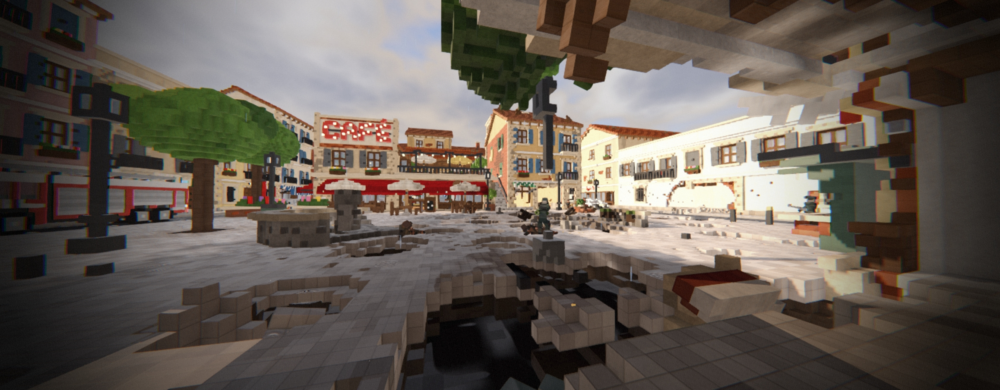
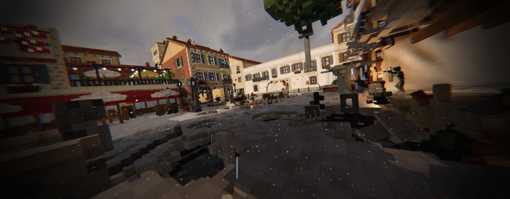

# 💥 BREACH

**Un shooter online en primera persona donde TODO se puede destruir.**
Paredes, columnas, techos, edificios enteros: cada bloque del mundo es físico, y si rompés lo que lo sostiene,
se cae de verdad, en tiempo real, y lo ven caer igual todos los jugadores de la partida.

Pensado como un *Call of Duty* para el celular con la destrucción de *Teardown*, y optimizado desde el primer día
para que corra en **celulares de gama baja**, así lo puede jugar cualquiera.

> Proyecto creado por **León Irusta**, desarrollado programando junto a **Claude Code** (la IA de Anthropic)
> como asistente de programación.



---

## 🎮 Cómo se ve

https://github.com/user-attachments/assets/08b817e3-f3c9-4e8b-b5a9-b535713d2000



---

## ✨ Qué tiene el juego

### 🧱 Destrucción total con física real
- **Todo el mundo está hecho de voxels** (bloques chiquitos de 10 a 20 cm) y todos se pueden romper: con balas,
  con el mazo, con granadas, con cohetes y con C4.
- **Análisis estructural en tiempo real**: el motor calcula qué está apoyado en qué. Si volás las columnas de
  la planta baja, el piso de arriba se viene abajo solo.
- **Física real** (motor Jolt): los pedazos caen, rebotan, se apilan y se pueden usar como rampa o cobertura.
- Cada material se comporta distinto: el metal aguanta varias balas, la madera y el ladrillo se rompen al toque.

### 🌐 Online, para jugar con amigos
- **Multijugador en tiempo real** por wifi (LAN) o por internet, con salas, amigos y equipos.
- La destrucción está **sincronizada**: el motor es determinista, así que cada jugador ve caer el mismo edificio
  de la misma forma.
- **Sistema anti-trampa en los disparos**: el servidor "rebobina" el tiempo para ver exactamente lo que veía el
  que disparó y decide si acertó.
- Si el internet directo no anda (datos móviles, la red de la facultad), la partida pasa sola por un **puente**
  en el servidor.

### 🕹️ Modos de juego
- **Bomba** (plantar y desactivar, al estilo Counter-Strike)
- **Duelo a muerte**: por equipos o todos contra todos
- **Battle royale** en una isla con vehículos que se manejan (autos, motos, helicópteros), solo o en escuadra
- **Atraco**
- **Prop hunt**: unos se transforman en muebles de la casa y otros los buscan
- **Zombis**: supervivencia por oleadas y una **campaña cooperativa de 8 episodios** al estilo *Left 4 Dead*,
  con puzzles, jefes y escenas de cine
- **Tutorial** interactivo que enseña a romper todo

### 🦸 Héroes y habilidades
- Personajes con **habilidades definitivas**: invisibilidad, blindaje con energía (estilo nanotraje de *Crysis*),
  un puñetazo dorado que abre túneles en las paredes, un salto que revienta el piso, un gancho...
- Cada héroe sube de nivel y desbloquea ventajas.

### 🏆 Progresión
- **Pase de batalla** (gratis y prémium), **camino del progreso** con 50 niveles, **tareas diarias y semanales**
- **Cofres** con animación de apertura, **cartas** de mejoras para armar tu mazo
- **Tienda** con skins, armas y pinturas, **armería** para armar tu equipo
- Logros, medallas en vivo, cámara lenta en los derrumbes grandes

### 🤖 Bots con inteligencia artificial
- Bots que patrullan, se cubren, rodean, buscan caminos con A* y pelean como jugadores.
- Su cerebro está escrito en C++ para que muchos bots juntos no bajen los FPS.

---

## ⚡ Optimizado para gama baja

El objetivo es que **funcione en cualquier celular**, no solo en los caros. La máquina de referencia es una PC
de gama baja (Intel i3-N305, gráficos integrados, 8 GB de RAM), y el celular es todavía más exigente. Algunas
de las optimizaciones:

- **Motor de voxels propio en C++**, sin dependencias, con el trabajo pesado repartido en varios hilos
  (mallado, análisis estructural, física de escombros).
- **LOD**: lo que está lejos se dibuja con menos detalle, y las sombras usan una malla simplificada aparte.
- **Luces "cocinadas"**: las farolas no cuestan nada por fotograma.
- **Lo que no se ve no se simula**: una explosión fuera de pantalla rompe igual, pero no gasta en partículas.
- Los escombros chicos se duermen y se limpian solos con el tiempo.
- El color de cada bloque viaja en una textura y no en la malla: hasta un 40 % menos de triángulos.
- **Todo medido con bancos de prueba repetibles**: más de 250 modos de prueba para medir FPS, red y física.

---

## 🖥️ Cómo jugar en PC

1. Descargá el proyecto (botón verde **Code → Download ZIP**) y descomprimilo.
2. Doble clic en **`JUGAR.bat`**.
   - La primera vez descarga el motor Godot 4.7.2 (~60 MB) e importa los recursos (unos minutos).
   - Las siguientes veces abre al instante.

**Requisitos:** Windows 10/11 de 64 bits, 4 GB de RAM y gráficos con Vulkan (sirven los integrados).

**Controles:** WASD moverse · ratón apuntar · clic izquierdo disparar · clic derecho mirilla · R recargar ·
G granada · Espacio saltar · Shift correr · X habilidad · Esc menú.

En Android se juega con controles táctiles que se pueden personalizar.

---

## 🛠️ Cómo está hecho

```
core/        Motor de voxels en C++17: mundo, destrucción, mallado, análisis estructural, navegación A*.
godot/       El juego en Godot 4: escenas, scripts (GDScript), mapas, modelos 3D, sonidos y shaders.
  extension/ El puente C++ entre el motor de voxels y Godot (GDExtension): render, física Jolt, escombros.
servidor/    Servidor en Node.js: cuentas, salas online, amigos, equipos, tienda y progreso.
admin/       App de administración (Godot) para gestionar cuentas, regalos, tienda y reportes.
tools/       Generadores de mapas y sonidos en Python, scripts de compilación y de modelos para Blender.
docs/        Documentación técnica (empezar por docs/RECORRIDO.md).
```

| Parte | Tecnología |
|---|---|
| Motor de destrucción | C++17 (sin dependencias), determinista para la red |
| Motor del juego | Godot 4.7 + GDExtension, física Jolt, renderer Vulkan |
| Lógica del juego | GDScript |
| Servidor | Node.js |
| Mapas | Generados con scripts de Python |
| Modelos y animaciones | Blender (scripts de Python) |
| Plataformas | Windows y Android |

### Recompilar el motor C++ (opcional)

El repositorio ya trae la DLL compilada. Para recompilarla hacen falta Visual Studio 2022, CMake y Ninja:

```bat
git clone -b 4.4 https://github.com/godotengine/godot-cpp godot/extension/godot-cpp
tools\build_extension.bat
```

---

## 🤝 Desarrollo con IA

Todo el proyecto (el motor en C++, el juego, el servidor, los mapas y las herramientas) lo desarrolló
**León Irusta** con **Claude Code** como compañero de programación: León dirige el diseño, prueba el juego y
decide qué se hace; la IA escribe e investiga el código y mide el rendimiento con los bancos de prueba.

---

## ⚖️ Licencia: todos los derechos reservados

**© 2026 León Irusta.** El código se publica **solo para que se pueda ver** como portafolio. Está **prohibido**
copiarlo, modificarlo (a mano o con inteligencia artificial), publicarlo, venderlo o usar sus imágenes, modelos,
mapas o sonidos sin permiso escrito del autor. Ver [LICENSE](LICENSE).

## 📝 Notas

- Esta versión **no incluye pagos con dinero real**: la pasarela de pago se quitó.

© León Irusta
