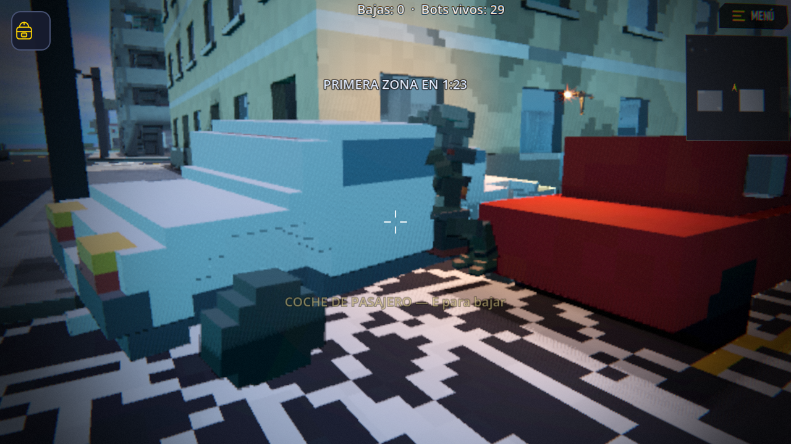

# Vehículos conducibles

Coches, todoterrenos, motos y un helicóptero, modelados con **voxels de 10 cm** en Blender y conducibles
en el battle royale de la isla. Este documento es el recorrido completo: qué archivo hace qué, cómo se
modela uno nuevo, cómo se conduce, qué manda en red y qué está medido.

---

## 1. Las piezas

```
tools/blender/vehiculos/voxel.py         rejilla de voxels de 10 cm -> malla de caras visibles
tools/blender/vehiculos/vehiculos.py     el catálogo: coche, todoterreno, moto, helicóptero
tools/blender/vehiculos/exportar_vehiculos.py   -> godot/vehiculos/*.glb + vehiculos.json
tools/blender/vehiculos/render_vehiculos.py     -> docs/vehiculos.png (hoja de contacto)

tools/generar_vehiculos_isla.py          -> godot/maps/isla.vehiculos.json (dónde aparecen)

godot/scripts/vehiculo.gd                UN vehículo: modelo, ruedas, conducción, daño
godot/scripts/vehiculos.gd               el gestor: qué existe, subirse, bajarse, red
```

`godot/vehiculos/vehiculos.json` es **la ficha** de cada modelo, ya en coordenadas de Godot: asientos,
ruedas con su radio, motor, escape, faros y (el helicóptero) rotores y patines. El juego **no mide nada
del modelo**: lee la ficha. Si mueves una rueda en Blender, se vuelve a exportar y ya está.

## 2. Modelar uno nuevo

```bat
blender -b --python tools/blender/vehiculos/exportar_vehiculos.py
blender -b --python tools/blender/vehiculos/render_vehiculos.py
```

Reglas que costaron una tarde:

- **Nada por debajo de 10 cm**, que es un voxel: una chapa de 6 cm **desaparece** (el voxel no coge el
  centro). Las paredes de cabina van a 0,20 (dos voxels) y los cristales a 0,10.
- **El perfil se TALLA, no se añade.** Poner cuñas encima de un bloque lleno no hace nada (ya hay materia
  ahí) y el coche salía como una camioneta: un ladrillo largo con una caja encima. El capó y la cola se
  vacían en escalones.
- **Nada del interior puede pasar del techo**: los reposacabezas asomaban por encima del coche como dos
  antenas.
- El cilindro de `voxel.py` **siempre crece hacia +eje**: para tallar el paso de rueda del lado negativo
  hay que empezar en el punto de más a la izquierda, o se talla el medio del coche.
- Se modela con el **morro a +Y** de Blender y +Z arriba. El exportador de glTF gira el mundo: un punto
  (x, y, z) de Blender es **(x, z, −y)** en Godot, que mira a −Z. Igual que las armas.
- Dos materiales: `carroceria` (color de vértice blanco, el juego la repinta) y `detalle` (color fijo).

**Los .glb hay que importarlos en Godot una vez** o el juego no los encuentra (`No loader found for
resource`). Basta con abrir el editor, o en consola:

```bat
Godot_v4.7.2-stable_win64.exe --headless --path godot --editor --quit-after 400
```

## 3. Dónde aparecen

```bat
python tools/generar_vehiculos_isla.py
```

Reparte 27 puntos a lo largo de las **carreteras** de `tools/mapa_isla/disposicion.py` (uno cada 58 m,
apartado del eje y mirando hacia donde va la calzada) más cuatro helicópteros en sitios abiertos y
golosos: la plaza de la ciudad, el puerto, una meseta del desierto y un claro del bosque.

El JSON lleva **`y: 0` a propósito**: la altura la resuelve el juego con un rayo hacia abajo al crear el
vehículo. Así sigue valiendo si el terreno cambia, y un coche en una calle que alguien ha volado cae a
donde esté el suelo ahora. Si el rayo no encuentra suelo (el punto ha quedado sobre el mar o sobre un
agujero), **ese punto no se usa**: antes el vehículo nacía en el aire y se caía del mundo con el jugador
dentro.

## 4. Sólo existe lo que está cerca

Igual que el botín: un vehículo parado a 300 m **no es un cuerpo de Jolt ni una malla**, es una entrada en
un `Array`. Dentro de `RADIO_VER` (160 m) se crea donde se quedó; al alejarte se apunta su postura y su
vida y se borra el nodo. El único que nunca se borra es el que estás conduciendo.

## 5. Conducir

- **E** (o USAR en el móvil) al lado de uno: te subes. **E** otra vez: te bajas, al lado por donde no haya
  pared. Mientras vas dentro, el jugador pasa a tercera persona y el vehículo le lleva la posición a mano
  (`paso_jugador`, el mismo enganche `player.br_control` que usa el avión del salto). El jugador **no es
  un cuerpo físico dentro de otro cuerpo**: eso sólo da temblores.
- **WASD** conduce, **agacharse** frena, y en el helicóptero **saltar/agacharse** es el colectivo (subir y
  bajar), WASD inclina y **el rumbo lo lleva la mirada**.
- La **moto** se endereza sola con un par: dos ruedas se acuestan en la primera curva y una moto que se
  cae no se puede jugar.
- Un coche **boca arriba del revés** dos segundos se da la vuelta solo. Quedarse tumbado en un descampado
  es perder la partida por nada.
- **Atropellar** hace daño por encima de 4 m/s (14 km/h) y escala con la velocidad: a 100 por hora mata.
- **Los golpes abollan, y de verdad.** El desgaste se mide por el **frenazo**: cuánta velocidad se pierde
  de un fotograma al siguiente. `body_entered` sólo avisa de choques contra otros cuerpos y el mundo es de
  voxels, así que contra una pared no saltaba nunca y el coche parecía indestructible. Medido: estrellarse
  a 97 km/h cuesta **278 de 800**; a cero el coche **revienta** (explosión, daño alrededor y agujero).
- **La zona te mata aunque vayas en coche.** Se perdonaba a todo el que tuviera `br_control` (eso era para
  el avión y el paracaídas); ahora sólo perdona si vas por el aire. Medido: 4 s fuera del círculo dentro
  de un coche = −20 de vida.

### Llevarse la pared por delante

Lo que tienes delante se rompe **según a qué velocidad llegues y con qué vehículo**:

| | por debajo de 16 km/h | a 50 km/h | a 80 km/h o más |
|---|---|---|---|
| moto (0,7 m de ancho) | nada | boquete de 0,8 m | 1,2 m |
| coche (1,8 m) | nada | 2,1 m | 3,2 m |
| todoterreno (2,1 m) | nada | 2,4 m | 3,7 m |

El **boquete va con el ancho del vehículo**: una moto abre un agujero de moto y un todoterreno se lleva un
trozo de pared de su tamaño. La **dureza** que es capaz de romper también sube con la velocidad (a poca,
sólo madera y matorral; a tope, todo). Cada embestida **te frena a la mitad y te abolla**, así que llevarse
un edificio por delante cuesta el coche.

Es un **tallado**, no una explosión: con `world.explode` salía fuego, humo y el estruendo de una granada
cada vez que rozabas una pared. Se usa `Net.net_carve_beam` (replicado, o el agujero sólo saldría en tu
máquina) y suena a material roto, igual que el golpe de manos del jefe del PvE.

Medido con `--map=isla --pruebaembestir`: moto a 92 km/h **104 voxels**, coche a 98 km/h **2.902**,
todoterreno a 80 km/h **2.680**, y a paso de hombre **0**.

## 5b. Los compañeros: un asiento cada uno

Cada modelo trae sus asientos en la ficha: **cuatro** el coche y el todoterreno, **dos** el helicóptero,
**uno** la moto. El asiento 0 es el del volante y los demás son de pasajero.

Al pulsar E te sientas en **el primer asiento libre**: si el coche está vacío te pones al volante, y si ya
lo lleva un compañero te subes de copiloto o detrás. Un coche que lleva otro **sí vale para subirse**; lo
único que no se puede es quitarle el volante a nadie. Al bajarte, tu asiento queda libre y sales por tu
lado (los de la izquierda por la izquierda), o por el otro si ahí hay pared.

Quién ocupa cada sitio se guarda **por número de asiento**, no por jugador, y viaja así por la red: el que
llega tarde se sienta detrás en todas las pantallas a la vez y dos no pueden caer en el mismo sitio.

Probado con `--map=isla --pruebaasientos`: con el volante y el copiloto cogidos por otros, el local acaba
en el asiento 2, va pegado a él, no se pone a conducir, y al bajarse su sitio queda libre.

## 5c. Sonido y cartel

El motor está **sintetizado desde cero** (`tools/generar_sonidos_vehiculos.py` → `godot/sounds/vehiculos/*.wav`):
un tren de explosiones de cilindro con su resonancia, en un bucle de **un segundo exacto** al que el juego
le cambia el tono y el volumen según las vueltas. Tres timbres: coche (cuatro cilindros), moto (dos, más
sucia) y helicóptero (turbina + pala-pala). Sólo suena el vehículo que está encendido: veintisiete coches
sonando a la vez no los paga la máquina de referencia. Aquí **no entra audio comercial**, es la regla del
proyecto.

Al acercarte sale una **"E"** sobre el vehículo, y nada más: el nombre del tipo y los asientos libres se
quitaron porque el jugador ya ve que es un coche y un cartel por vehículo ensucia el mapa.

## 5d. Sentado dentro, y asomarse a disparar



Dentro del vehículo el muñeco **va sentado de verdad**: `avatar_animator` tiene una pose (`sentado`) que
dobla caderas, rodillas y tobillos por encima de lo que haya, y pone las manos **al volante** si conduces
o caídas si vas de pasajero. No es un clip nuevo: es una pose encima del reposo, así que vale para el
jugador, para los remotos y para los bots.

- **En tercera persona** te ves sentado dentro, sin atravesar el techo.
- **El modo de cámara es tuyo, no del coche**: al bajarte se te devuelve el que tenías. Forzar primera
  persona al salir dejaba al que juega en tercera sin verse y con la cámara pegada a la cara.
- **En primera persona no se dibujan los brazos**: los de primera persona cuelgan de la cámara, no están
  sentados, y quedaban flotando delante de la cara. Vuelven a aparecer al asomarte a disparar, que es
  cuando quieres ver tu arma.
- **Los demás te ven igual**: cuando llega el aviso de asiento por la red, cada máquina le pone la misma
  pose al muñeco del otro.

**Dentro de un vehículo no se dispara.** Se probó lo de asomarse por la ventanilla y no compensaba: el
muñeco quedaba medio subido a la puerta, más "de pie al lado del coche" que asomado. Si vas dentro, vas
dentro; para tirar, te bajas. La ficha sigue trayendo `ventanillas` por si algún día se retoma.

**Los bots también se sientan**: `vehiculo.sentar_bot(bot, asiento)` los lleva al asiento y les pone la
misma pose (su avatar es el mismo que el del jugador). Probado con `--pruebabotcoche`, que mide sus huesos
y saca una foto desde fuera. Dentro hay una **luz de habitáculo** que se enciende sólo cuando va alguien:
con el interior a oscuras, el cristal se leía como chapa negra y no se veía quién iba dentro.

**Los cristales son transparentes** y van en su propio material (`cristal`, alpha 0,34, exportado como
`alphaMode: BLEND`): con el cristal opaco el coche parecía macizo y no se veía a nadie dentro.

**Los pies, en el piso de la cabina**: la ficha trae `suelo_cabina` y el jugador se coloca ahí. Antes se
bajaba una altura fija y las piernas atravesaban la chapa por debajo. Y como un tipo de 1,80 **sentado
mide 1,30 del piso a la coronilla** (medido con los huesos), el coche tuvo que crecer: piso a 0,34,
techo a 1,82 — un crossover, no un utilitario bajo. El pickup bajó su piso a 0,66 por lo mismo.

**Los `.glb` hay que reimportarlos en Godot cada vez que se re-exportan** (abrir el editor o
`--headless --editor --quit-after 600`). Si no, el juego sigue usando la versión vieja: el material de
cristal no aparecía por ningún lado aunque el `.glb` ya lo traía.

Cosas que sólo se vieron midiendo (`--pruebasentado`, que mide dónde cae cada hueso respecto a la
caja del coche, porque una foto no sirve: el propio coche tapa al muñeco):

- **El habitáculo no cabía.** El suelo interior estaba a 1,00 m y el techo a 1,44: 44 cm para una persona
  sentada, y la cabeza salía por el techo (2,66 m con el techo a 1,50). Ahora el hueco baja hasta 0,52 y
  el coche mide 1,62 de alto.
- **El jugador se coloca por los pies**, no por el asiento: hay que bajarlo 80 cm para que la coronilla
  quede a la altura de alguien sentado.
- **Sin quitar la colisión, la física te escupe**: al asomarte, la cápsula del jugador y el cuerpo del
  coche se empujaban y acababas a dos metros. Dentro del vehículo el jugador va sin colisión, que ya lo
  coloca el coche cuadro a cuadro.
- Y el exportador **no copiaba el campo `ventanillas`** a la ficha, así que nadie se asomaba nunca.

## 5e. Cada coche de su color

La carrocería va en un material aparte justo para esto: el juego la repinta al crear el vehículo con un
color sacado **del número del punto del mapa**, no de un `randf`. Así el coche rojo de la esquina es rojo
en todas las pantallas sin mandar nada por la red. Diez colores de aparcamiento (rojo, azul, verde,
amarillo, negro, gris, marrón, morado, turquesa y naranja) y **ninguno blanco**: en un mapa de voxels
claros, un coche blanco desaparece contra el suelo.

## 5f. El helicóptero

Dos fallos que lo dejaban inútil, los dos míos:

- **El eje del rotor no se convertía a coordenadas de Godot.** La posición sí pasaba por la conversión
  Blender→Godot, pero el eje se copiaba tal cual: el rotor principal gira sobre **Z en Blender, que en
  Godot es la Y**. Con `"z"`, las palas daban vueltas de lado, sobre el eje del morro.
- **La embestida lo frenaba a la mitad en cada fotograma.** Su rayo de morro pillaba el suelo al
  inclinarse, así que con el colectivo a tope subía **5,8 m en ocho segundos** (y se abollaba solo). Un
  helicóptero no abre boquetes: ahora no embiste, y sus golpes sólo cuentan si está posado.
- Además su caja de colisión se calculaba con un radio de rueda… que no tiene, así que empezaba 56 cm por
  encima del suelo y el aparato se hundía en el terreno.

Medido después: **sube 160 m y va a 101 km/h**, sin perder vida.

## 5g. Ni a prueba de balas, ni de hélices

**Las balas rompen el vehículo.** Cada impacto llama a `Vehiculo.danar_bala()`: saltan chispas donde
pega, suena la chapa y se le quita vida. No es plano — donde das importa:

| Dónde | Multiplica |
|---|---|
| chapa (puertas, costados) | ×1,0 |
| cristales (parte de arriba) | ×1,8 |
| motor (el morro) | ×1,5 |

Cuando se le acaba la vida revienta igual que si lo estrellaras (`reventar()` → explosión y daño
alrededor). Medido con la carabina 5.56 en la isla: **800 → 0 de vida en 19 tiros**.

Ojo con el camino que sigue la bala: el vehículo es un cuerpo de física normal, así que el rayo del
disparo lo encuentra solo. Lo que faltaba era la rama que lo trata como vehículo — sin ella caía en
la de "cascote de voxels" (`hit.rid`), que intenta tallar un bloque, y por eso **no pasaba nada**.
Disparan igual el jugador (`player.gd`) y los bots (`enemy.gd`).

**Las hélices cortan lo que tocan.** Un rotor a esas revoluciones no rebota: parte. Mientras gira por
encima de `ROTOR_GIRO_MIN`, se miran unos puntos del borde del disco (que giran con él, así que lo
barren entero):

- si hay **mundo**, se talla un boquete replicado (`Net.net_carve_beam`) y el helicóptero se gasta un
  poco de vida por mordisco;
- si hay **una persona**, se lleva 250 de daño, o sea que muere.

Quien va dentro no se corta con su propio rotor: se saltan el conductor y el pasajero locales, los
bots sentados (`_bots`) y los jugadores de otras máquinas que ocupen un asiento (`ocupados`).

Medido en la isla con el disco metido en el suelo: **38 mordiscos y 250 voxels menos en 2,5 s**, y el
helicóptero se gasta 152 de sus 900 de vida — unos diez segundos comiendo hormigón antes de caerse.

Dos cosas que costaron:

- **El radio del disco sale de la malla**, porque la ficha no lo trae. Mirando sólo a los hijos del
  nodo salía 0 (el rotor *es* la malla, no un padre con palas dentro) y la hélice no tocaba nada; y
  sumando tamaño y posición de la caja salía **el doble** (10,6 m en vez de 5,3), con el disco
  cortando al doble de distancia.
- **El daño propio**: con 40 por mordisco, a 20 mordiscos por segundo, el helicóptero se destrozaba
  solo en segundo y medio de rozar una pared. Está en 4.

---

## 6. Quién manda en red

Manda **quien conduce**: su máquina lleva la física y manda la postura 20 veces por segundo
(`Net.net_vehiculo`, no fiable y ordenado); las demás la copian en un cuerpo congelado, interpolando. Dos
físicas discutiendo por el mismo coche no se ponen de acuerdo nunca — es lo mismo que ya se hace con los
bloques.

Sentarse y levantarse sí va **fiable a todos** (`Net.net_vehiculo_asiento`): dos que llegan a la vez a la
misma moto no pueden subirse los dos.

## 7. Probarlo

```bat
Godot_v4.7.2-stable_win64.exe --path godot -- --map=isla --pruebavehiculo [--tipo=coche|moto|todoterreno|helicoptero]
```

Lleva al jugador al vehículo más cercano de ese tipo, se sube, acelera 8 s, y dice cuánto ha recorrido, a
qué punta, cuánto ha subido y si se ha bajado bien.

```bat
:: balas contra la chapa y la helice cortando (isla)
Godot_v4.7.2-stable_win64.exe --path godot -- --map=isla --pruebabalasvehiculo
```

## 8. Lo que costó (medido, no supuesto)

- **La caja de colisión rozaba el suelo.** Estaba centrada demasiado baja y el bajo quedaba por debajo del
  eje de las ruedas: el coche iba arrastrando la panza y no pasaba de 42 km/h con el motor a tope. Ahora
  el bajo de la caja se calcula **a partir del radio de la rueda más grande**.
- **Cortar el gas no es un tope de velocidad.** La moto llegó a 238 km/h cuesta abajo (el par que la
  endereza también mete energía). Por encima del tope se frena la velocidad, no sólo el motor.
- **Un punto sin suelo debajo tiraba al jugador fuera del mundo** (acabó a y = −497). Ahora se descarta.
- **Un vehículo lejos no tiene suelo.** El mundo de voxels sólo le pone cuerpos de Jolt a los chunks de
  alrededor del jugador, así que un coche creado a 150 m se caía del mapa (una moto acabó a −62 m y el
  helicóptero a −28). Ahora **sólo tienen física dentro de 55 m**; más lejos están congelados en su sitio,
  que además no cuesta nada. Y si alguno aparece por debajo del suelo sin nadie dentro, vuelve encima.
- **E te subía y te bajaba en el mismo fotograma.** `player.interact()` te sentaba y, en ese mismo cuadro,
  el vehículo veía la misma pulsación de "interact" como recién pulsada y te bajaba: parecía que la tecla
  no hacía nada y te quedabas plantado al lado de la puerta. Ahora hay que llevar 0,3 s dentro para poder
  bajarse, y `--pruebaentrar` **pulsa la tecla de verdad** en vez de llamar a la función.
- **W iba marcha atrás y A giraba a la derecha.** En Godot la fuerza **negativa** del motor empuja hacia
  −Z, que es hacia donde mira el vehículo: el signo iba en la fuerza, no en la entrada.
- **Los muelles blandos no quitan el rebote, lo empeoran.** Ablandando la suspensión el coche se hundía
  hasta arrastrar el chasis y no pasaba de 4 km/h. Lo que quita el bote en un suelo de voxels es
  **amortiguar** (sobre todo al estirarse) con el muelle firme, y que el bajo de la caja de colisión quede
  22 cm por encima del eje.
- **Salirse del mapa a 117 por hora** dejaba al jugador en y = −129. Ahora el vehículo revienta al pasar
  del fondo del mundo, y el que se mete en el mar **se cala y te deja fuera nadando**.

Medido al final (isla, `--pruebavehiculo`, 8 s acelerando desde parado, cuesta arriba o abajo según el
punto que toque): coche 44-84 km/h, moto 82-117 km/h, helicóptero sube 160 m y va a 101 km/h.

## 9. Lo que falta

- Los bots no conducen ni se suben de pasajeros.
- **Nada de esto está probado en móvil ni en LAN de verdad.**
